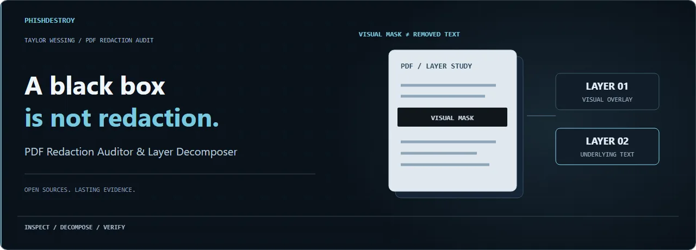
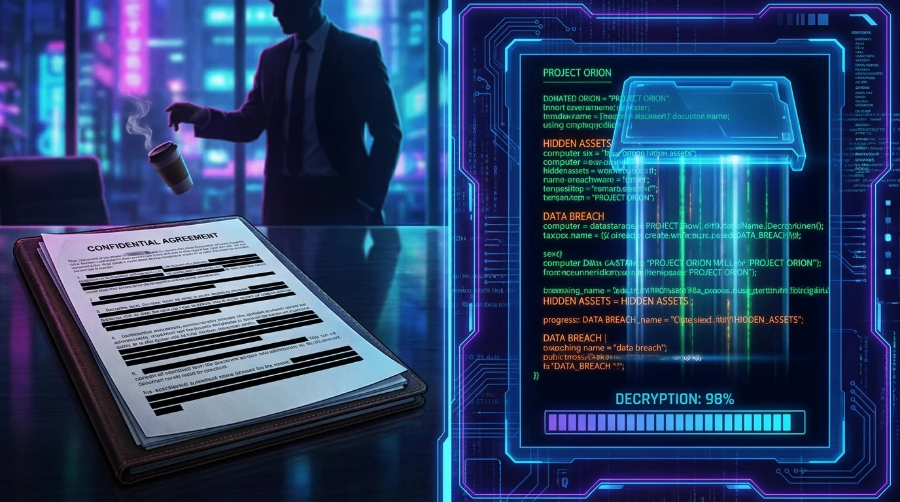

# 📡 THE TAYLOR WESSING DATA BREACH TOOLKIT
### 🛡️ Universal Forensic Audit & Layer Decomposition Suite for Insecure PDF Redactions

<p align="center">
  
  
  
</p>

<p align="center"><picture><source media="(max-width:600px) and (prefers-reduced-motion:reduce)" srcset="assets/readme-presentation/hero-mobile-poster.webp" /><source media="(prefers-reduced-motion:reduce)" srcset="assets/readme-presentation/hero-poster.webp" /><source media="(max-width:600px)" srcset="assets/readme-presentation/hero-mobile.webp" /></picture></p>

<p align="center">
<a href="https://phishdestroy.github.io/taylor-wessing-data-breach-toolkit/"></a>
<a href="https://raw.githubusercontent.com/phishdestroy/taylor-wessing-data-breach-toolkit/main/pdf-redaction-auditor.zip"></a>
<a href="https://phishdestroy.io/valve-profits-from-stolen-accounts"></a>
</p>

<details>
<summary><strong>Original cover artwork · open full-size originals</strong></summary>

<p align="center"><a href="image.png"></a></p>

</details>

> [!IMPORTANT]
> ### 🛡️ A Tool for Victims of Corporations: High-Priced Lawyers Do Not Equal Competence.

<p align="center"></p>

## 🔍 Executive Summary

The **Universal PDF Redaction Auditor & Layer Decomposer** is a professional, offline-first forensic auditing and layer decomposition suite specifically engineered to identify, verify, and sanitize visual-only PDF redaction vulnerabilities. This toolkit serves as an open-source utility for security researchers, data protection officers, and compliance auditors to verify document structural integrity before public disclosure.

### ⚖️ Technical Power Asymmetry & Opponent Vulnerability
This auditing utility is built to address a critical power imbalance in corporate data processing. When massive conglomerates (such as **Valve Corporation**) are represented by elite law firms (such as **Taylor Wessing LLP**), any systematic data exposure doesn't hurt the corporation or their high-priced lawyers—it catastrophically compromises the privacy of their **opponents** (the individual data subjects, third-party users, and minors whose sensitive personal data is leaked due to legal and technical negligence). This toolkit empowers individuals and independent auditors to verify data safety and hold corporate actors accountable.

<p align="center"></p>

## 📊 Case Study: The Taylor Wessing / Valve GDPR Leak

During the processing of GDPR Article 15 Subject Access Requests (SARs) regarding Steam user data, a critical security vulnerability was identified in documents processed and dispatched by external counsel **Taylor Wessing LLP** on behalf of **Valve Corporation**.

### Technical Failure Analysis
Instead of permanently sanitizing the raw character arrays inside the PDF content streams, an automated, custom PDF generation pipeline (utilizing *Aspose.PDF for .NET*) was deployed. This system programmatically queried coordinates of sensitive fields and drew **solid black vector shapes** (using PDF's `re` and `f`/`F`/`b`/`B` operators) on top of the text.

Because visual drawing layers do not alter or destroy the raw text arrays underneath, thousands of unredacted private records—including account credentials, logins, emails, security logs, and de-anonymized data of minors—remained fully intact, copyable, and extractable from the dispatched files.

### 🌐 A Universal, Multi-Vendor Audit Suite
Please note: **This toolkit is NOT limited to a single-firm exploit.** It is a universal, standard-compliant PDF structural debugger and layer decomposer. If any law firm, financial institution, government body, or corporation in the world performs visual-only redaction instead of proper data scrubbing, this multi-tool will immediately expose it. 

We sincerely hope that other international law firms are more responsible with client confidentiality and aren't too cheap to pay for standard, certified redaction software instead of writing custom, broken "DIY" script pipelines. This in-house development was a catastrophic mistake—especially considering that the outdated version of the engine they chose to compile (*Aspose.PDF 20.8*) is known to suffer from severe, unpatched security vulnerabilities, including **Remote Code Execution (RCE)**. But apparently, self-proclaimed "IT lawyers" don't care about basic system security or unpatched code execution flaws. :)

<p align="center"></p>

> [!CAUTION]
> ### 🚨 DIALOGUE WITH DR. PATRICK (THE COVER-UP)
> PhishDestroy formally notified Taylor Wessing LLP's DPO and Salary Partner, **Dr. Patrick Zurheide**, regarding this massive, systematic exposure of Steam users' PII under GDPR Article 32. 
> 
> The response received confirmed that the firm is completely inadequate, deeply incompetent, and has **absolutely no intention of notifying affected data subjects, taking accountability, or warning the public**. 
> 
> They thought they could silence the community with expensive legal threats, but they forgot one thing: **the truth is written losslessly inside the byte streams.**

<details>
<summary><b>📂 Click to Reveal Exhibit A: Leaked Correspondence with Dr. Patrick Zurheide</b></summary>
<br>

### Exhibit A: The "Entertaining" Data Breach

Below is the exact, unedited response received from **Dr. Patrick Zurheide** (Salary Partner at Taylor Wessing LLP) after PhishDestroy formally notified the firm of their catastrophic PDF redaction failure and the subsequent leak of Steam users' data.

Instead of initiating a GDPR Article 33 breach notification, he chose to write this:

> **From:** p.zurheide@taylorwessing.com
> **Date:** August 19, 2026
> 
> "Guten Tag PhishDestroy-Team,
> 
> Vielen Dank für Ihre anscheinend übersetzte, aber durchaus unterhaltsame Nachricht. Auf welche Kommunikation „mit strafrechtlicher Verfolgung“ an das PhishDestroy-Team referenzieren Sie denn? Ich bin mir sicher mit PhishDestroy in keiner Form jemals zuvor kommuniziert zu haben. Bitte stellen Sie diese angebliche Kommunikation daher bereit, um zu verstehen, worum es überhaupt geht.
> 
> Ihrem Schreiben ist inhaltlich leider schwer bis gar nicht zu folgen. Als Hinweis: Ein Disclaimer, wie unten in Ihrem Schreiben, was vermeintlich nicht gemacht/beabsichtigt wird, ist bedeutungslos, wenn diesem die eigentlichen Handlungen entgegenstehen.
> 
> Patrick Zurheide"

<p align="center"></p>

### 🔍 PhishDestroy Translation & Analysis for the Non-German IT Community:

1. **"Vielen Dank für Ihre anscheinend übersetzte, aber durchaus unterhaltsame Nachricht."**
   * *Translation:* "Thank you for your apparently translated, but quite entertaining message."
   * *Analysis:* A highly paid "IT Law Expert" just called a forensic notification of a massive GDPR data leak—involving minors' exposed Steam accounts—"entertaining." 

2. **"Ich bin mir sicher mit PhishDestroy in keiner Form jemals zuvor kommuniziert zu haben."**
   * *Translation:* "I am sure I have never communicated with PhishDestroy in any form before."
   * *Analysis:* The classic corporate lawyer tactic of playing dumb. He ignores the fact that he sent criminal threats to the very Steam user we are assisting, choosing instead to argue semantics about the "PhishDestroy" brand name rather than fix his leaking servers.

3. **"Ihrem Schreiben ist inhaltlich leider schwer bis gar nicht zu folgen."**
   * *Translation:* "Unfortunately, the content of your letter is difficult or impossible to follow."
   * *Analysis:* We provided him with exact hex-values, the metadata of his PDF, the 36-second batch pipeline timestamps, and the specific `Aspose 20.8` version causing the leak. Apparently, IT metrics are too "difficult to follow" for a Doctor of IT Law.

**Conclusion:** 
When the people gatekeeping EU data privacy treat severe security vulnerabilities as a joke and prioritize their egos over compliance, the public must take auditing into their own hands. That is why this Toolkit exists.
</details>

### 📚 MUST-READ INVESTIGATIVE WRITEUPS:
* **🔬 Read the Full Case Study:** [Valve's Profits From Stolen Steam Accounts](https://phishdestroy.io/valve-profits-from-stolen-accounts)
* **📰 Read Part 1 (Medium Writeup):** [Exposing the Valve Data Breach & Corporate GDPR Negligence](https://phishdestroy.medium.com/my-dog-vs-elite-gdpr-lawyers-the-valve-data-breach-nobody-is-talking-about-f6f7683d813d)
* **📰 Read Part 2 (Medium Writeup):** [Exposing the 5-Year PDF Redaction Vulnerability inside Global Corporations](https://phishdestroy.medium.com/my-dog-vs-elite-lawyers-part-2-the-5-year-pdf-vulnerability-exposing-global-corporations-81cdad269253)

<p align="center"></p>

## 🛠️ MULTI-TOOL CAPABILITIES

This suite offers three complementary, fully client-side modes to analyze and dismantle fake visual redactions from Taylor Wessing or any other incompetent organization:

| Mode / Feature | Technology | Target Elements | Output Format |
| :--- | :--- | :--- | :--- |
| **📡 Mode 1: X-Ray Scanner** | PDF.js (Mozilla) | Searchable Text Layers | Live Terminal Stream |
| **✂️ Mode 2: Layer Stripper** | PDF-Lib (Indirect Objects) | Vector Paths (`re`, `f`, `b`) | Lossless Clean PDF |
| **🔎 Mode 3: Collision Audit** | PyMuPDF (Fitz Layout) | Overlapping Text & Graphics | `.txt` Leaks Report |

<br>

<details>
<summary><b>🛰️ Expand Mode 1 Details (X-Ray Live Terminal)</b></summary>
<br>

Splits your workspace into a responsive dual-pane view:
* **Left Pane:** Renders the visual PDF, displaying the black masking blocks.
* **Right Pane:** A synchronized green-on-black terminal that losslessly pulls the underlying unredacted text characters in real-time as you flip pages. You see the black box, but you read the secret instantly.
</details>

<details>
<summary><b>✂️ Expand Mode 2 Details (Surgical Layer Stripper)</b></summary>
<br>

A surgical, global stream-level sanitization engine:
* **Deep Stream Swapping:** Scans every single xref indirect object in the PDF—including Page Contents and nested **Form XObjects** (where template drawings are hidden).
* **Operator Purge:** Replaces rectangular visual paint commands (`re f`, `re F`, `re b`, `re B`, etc.) with the `n` (no-paint) operator. It physically deletes the black bars, dropping Page 1 black drawings to **exactly 0**, leaving a clean, naked document for download.
</details>

<p align="center"></p>

## 💻 CLI USAGE (`decensor.py`)

<details>
<summary><b>🔧 Click to Expand CLI Setup & Requirements</b></summary>
<br>

### Requirements
- Python 3.x
- PyMuPDF library

Install the required library on your local system:
```bash
pip install pymupdf
```
</details>

<details>
<summary><b>📡 Click to Expand CLI Command Reference</b></summary>
<br>

```bash
# 1. Decompose PDF to raw text layers (Strips all drawings, lines, and masks globally)
python decensor.py -i compromised.pdf -d -o naked_document.pdf

# 2. Extract and save all text hidden under black visual shapes to a leaks text report
python decensor.py -i compromised.pdf -e verified_leaks.txt

# 3. List page-by-page structural element counts (drawings, images, text blocks)
python decensor.py -i compromised.pdf -l

# 4. Standard stream-level sanitization
python decensor.py -i compromised.pdf -o unmasked.pdf
```
</details>

<p align="center"></p>

## 🔍 CODE WALKTHROUGH

<details>
<summary><b>🐍 View Python Global Stream Sanitizer</b></summary>
<br>

The core script uses PyMuPDF's low-level stream reading interfaces. It parses the decompressed cross-reference (`xref`) stream of each page and resource, applies a whitespace-preserving regular expression to swap visual fill operators with a non-painting operator, and reconstructs the PDF stream with full garbage collection and stream deflation.

```python
import re, fitz

def strip_black_bars_global(input_path, output_path):
    doc = fitz.open(input_path)
    for xref in range(1, doc.xref_length()):
        if not doc.is_stream(xref):
            continue
        try:
            # Skip binary streams (Fonts, Images, Halftones)
            obj_dict = doc.xref_object(xref)
            if any(m in obj_dict for m in ["/Type /Font", "/Subtype /Image", "/Type /Halftone"]):
                continue
                
            stream_bytes = doc.xref_stream(xref)
            text = stream_bytes.decode('latin-1')
            
            # Swap rectangular painting operators with no-fill 're n', preserving newlines
            modified_text, count = re.subn(
                r'\bre\s+([fFbB]\*?)(?=\s|$)',
                lambda m: f"re{m.group(0)[2:-len(m.group(1))]}n",
                text
            )
            if count > 0:
                doc.update_stream(xref, modified_text.encode('latin-1'))
        except Exception:
            continue
    doc.save(output_path, garbage=4, deflate=True, clean=True)
    doc.close()
```
</details>

<details>
<summary><b>☕ View Javascript Browser-Side Sanitizer</b></summary>
<br>

The Web GUI performs the identical structural modifications in-memory using `pdf-lib` via low-level object context mapping.

```javascript
async function sanitizePdfClientSide(rawPdfBytes) {
    const { PDFDocument, PDFName, decodePDFRawStream } = PDFLib;
    const pdfDocInstance = await PDFDocument.load(rawPdfBytes);
    const context = pdfDocInstance.context;
    const indirectObjects = context.enumerateIndirectObjects();
    
    for (let i = 0; i < indirectObjects.length; i++) {
        const [ref, pdfObject] = indirectObjects[i];
        
        if (pdfObject && typeof pdfObject.getContents === 'function' && pdfObject.dict) {
            const dict = pdfObject.dict;
            const type = dict.get(PDFName.of('Type'));
            const subtype = dict.get(PDFName.of('Subtype'));
            
            if (type === PDFName.of('Font') || subtype === PDFName.of('Image') || type === PDFName.of('Halftone')) {
                continue;
            }
            
            try {
                const rawData = decodePDFRawStream(pdfObject).decode();
                const text = Array.from(rawData, byte => String.fromCharCode(byte)).join('');
                const modifiedText = text.replace(/re(\s+)([fFbB]\*?)(?=\s|$)/g, 're$1n');
                
                if (text !== modifiedText) {
                    const modifiedData = new Uint8Array(modifiedText.length);
                    for (let k = 0; k < modifiedText.length; k++) {
                        modifiedData[k] = modifiedText.charCodeAt(k) & 0xff;
                    }
                    
                    const newStreamObj = context.flateStream(modifiedData);
                    const keys = dict.keys();
                    for (let k = 0; k < keys.length; k++) {
                        const key = keys[k];
                        if (key !== PDFName.of('Filter') && key !== PDFName.of('Length')) {
                            newStreamObj.dict.set(key, dict.get(key));
                        }
                    }
                    context.assign(ref, newStreamObj);
                }
            } catch (err) {
                continue;
            }
        }
    }
    return await pdfDocInstance.save();
}
```
</details>

<p align="center"></p>

## ⚖️ ANTI-CENSORSHIP GUARANTEE (SECURITY.md)

Any legal warnings, DMCA takedown requests, or hostile actions initiated by Taylor Wessing LLP, Valve Corporation, or their attorneys to censor this repository **will be treated as public, undeniable proof of attempting to hide their own technical and professional incompetence**.

Such actions will trigger immediate, automated mirroring across decentralized filesystems and escalation of complaints directly to the European Data Protection Board (EDPB).

<p align="center"></p>

## ⚖️ Trademark Defense & Nominative Fair Use Clause

To the legal representatives of Taylor Wessing LLP contemplating a Trademark/UDRP or GitHub Terms of Service complaint regarding the use of your firm’s name in this repository title:

### 1. No Trademark Infringement
We do not use your corporate logo, branding assets, or trade dress. The use of the text string "Taylor Wessing" is strictly limited to Nominative Fair Use. It is used solely to factually identify the specific entity that generated the compromised GDPR documents which this tool was built to audit. There is zero likelihood of confusion—no reasonable person would believe this forensic tool is sponsored, endorsed, or created by a law firm that doesn't even know how to properly sanitize a PDF.

### 2. Public Interest & Compliance Tooling
We found it highly unpleasant to associate our clean, open-source repository with your brand. However, it was a necessary technical decision.
Since you have demonstrated a clear unwillingness to invest in specialized data-sanitization software—and an even greater unwillingness to fulfill your GDPR obligations by notifying the victims of your data leaks—we had to build a compliance tool for you and your victims.

The name of this repository serves as a Search Engine Optimization (SEO) beacon. It ensures that when your clients, legal opponents, or individual victims search for their documents online, they will find this utility and discover that their data has been compromised due to your negligence.

### 3. Warning Against Fraudulent Takedowns
Any attempt to abuse Trademark law or GitHub's takedown procedures to silence this repository will not be viewed as a legitimate intellectual property dispute. It will be documented as a bad-faith attempt to use copyright/trademark law to censor a security tool and hide your ongoing GDPR Article 32 violations.

<p align="center"></p>

> [!NOTE]
> ### 🔒 ZERO-KNOWLEDGE PRIVACY GUARANTEE
> This tool runs **100% in your local sandbox** (either inside your browser or via local Python execution). 
> * No telemetry or tracking scripts.
> * Zero network requests are initiated during PDF parsing or sanitization.
> * Your sensitive files never leave your computer.
